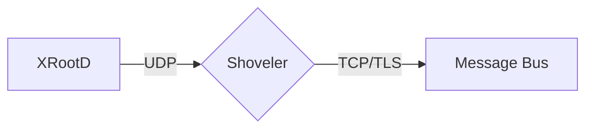

# Derek's Webiste


## How to build:

With drafts:

```
bundle exec jekyll serve --config _config.yml,_config.dev.yml --drafts
```

## Mermaid diagrams

Write a fenced `mermaid` block in a post. An optional kramdown attribute line
directly after the closing fence becomes the figure caption:

````markdown

{: data-caption="Monitoring records flow from XRootD to the message bus."}
````

No front matter is needed. `_layouts/default.html` includes `_includes/mermaid.html`
only on pages whose content has a `mermaid` block, so other pages never load Mermaid.
Diagrams use the site palette and fonts, redraw when the light/dark toggle changes,
and scale down to fit the post column. If a diagram fails to parse, its source stays
on the page as a code block and the error goes to the browser console.

Mermaid loads from jsDelivr at the exact version pinned in `_includes/mermaid.html`.
To upgrade, change that version and check a diagram in both themes.
