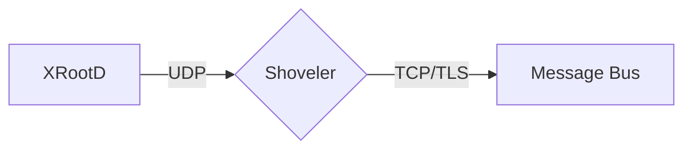

# Derek's Webiste


## How to build:

With drafts:

```
bundle exec jekyll serve --config _config.yml,_config.dev.yml --drafts
```

## Mermaid diagrams

Write a fenced `mermaid` block in a post. An optional kramdown attribute line
directly after the closing fence becomes the figure caption:

````markdown

{: data-caption="Monitoring records flow from XRootD to the message bus."}
````

No front matter is needed. `_layouts/default.html` includes `_includes/mermaid.html`
only on pages whose content has a `mermaid` block, so other pages never load Mermaid.
Diagrams use the site palette and fonts, redraw when the light/dark toggle changes,
and scale down to fit the post column. If a diagram fails to parse, its source stays
on the page as a code block and the error goes to the browser console.

Mermaid loads from jsDelivr at the exact version pinned in `_includes/mermaid.html`.
To upgrade, change that version and check a diagram in both themes.

## Charts

Posts can draw Chart.js charts from a `_data` file:

1. Put the rows in `_data/`, one row per x value. For example,
   `_data/osdf_monthly.csv` has the columns `month,osdf_transfers,gracc_jobs`.
2. Describe the chart in `_data/charts/` under the same name.
   `_data/charts/osdf_monthly.yml` uses every option: a title that states the
   finding, a subtitle, a `description` for screen readers, the x column, each
   series (`type: bar` or `line`, `color: accent` or `reference`, and the `unit`
   tooltips use) and callouts on single points.
3. Add `charts: true` to the post's front matter, then include the chart where
   it should appear:

   ```liquid
   
   ```

   `id` must be unique on the page. `caption` is markdown for the figure
   caption, and `config` names a spec in `_data/charts/` when it isn't named
   after the data file.

Only pages with `charts: true` load Chart.js and `chartjs-plugin-annotation`.
Both come from jsDelivr at the versions and SRI hashes pinned in
`_includes/chart-scripts.html`. Charts use the site palette (the `--chart-*`
properties in `assets/css/main.scss`) and Space Grotesk, and redraw when the
light/dark toggle changes. Below a 560px plot width the right-hand series
labels drop out and the legend above the plot names the series. Every value
is also in a collapsible table under the plot, which is what feeds and
readers without JavaScript get.

To upgrade, change a version and its `integrity` value together, then check a
chart in both themes and at phone width. To get the hash:

```
curl -s https://cdn.jsdelivr.net/npm/chart.js@VERSION/dist/chart.umd.min.js | openssl dgst -sha384 -binary | openssl base64 -A
```
