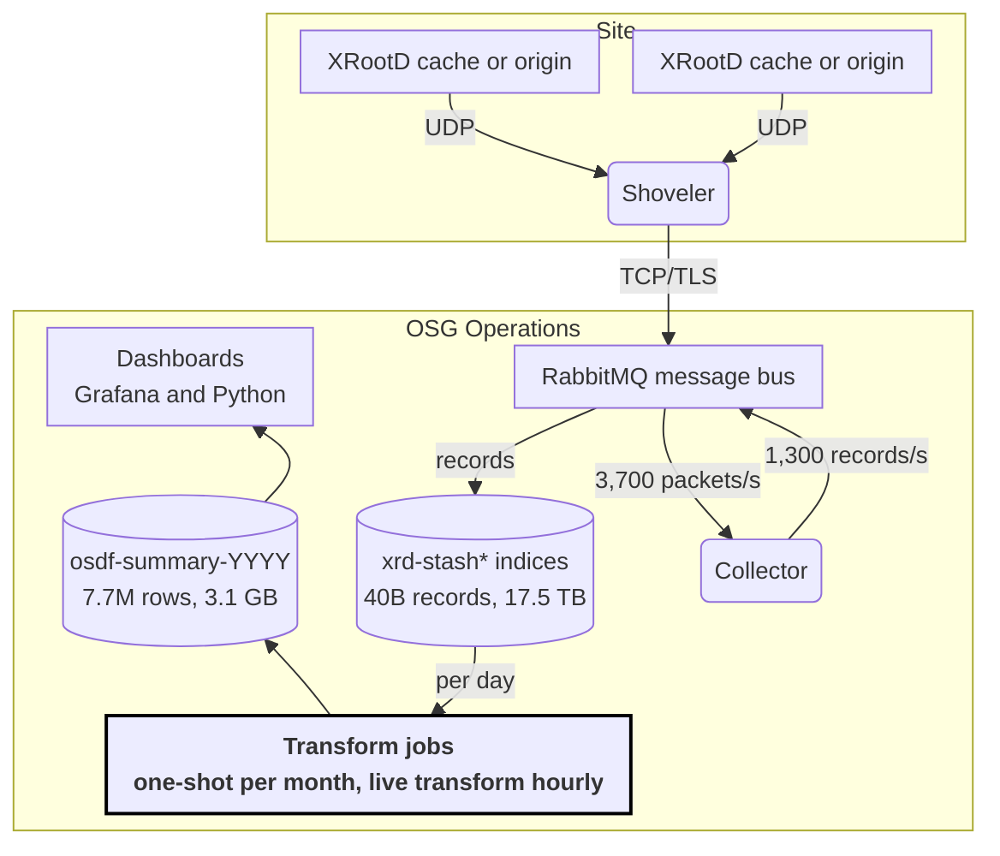

The Open Science Data Federation (OSDF) now produces about two billion file-transfer records a month, roughly 780 a second so far in 2026 and close to 2,000 a second at peak. That is about 17 times the 2021 rate, 39 times the rate of job records in GRACC, our long-standing job accounting system, and 6 to 11 times the OSPool's HTCondor accounting records. To keep this data queryable, we summarize it into one row per day for each combination of directory, server, site and user domain with OpenSearch transform jobs. The summaries are more than 8,000 times smaller than the raw records, and questions that took minutes against the raw records now answer in under a second. The price is per-file detail: the summaries can say how much a directory moved on a day, but not which files.

## Motivation

In 2026 OSDF has recorded 17 times as many file transfers a second as it did in 2021, and most of that growth came in the last 18 months. XRootD monitoring on each cache and origin reports every event of a transfer, such as a file open and a file close, often in separate packets. The events pass through RabbitMQ to the collector, which joins each transfer's events into one record and stores it as one document in OpenSearch. Each transfer record counted here therefore stands for several messages through RabbitMQ and the collector.

| Calendar year | Transfer records | Average per second |
| --- | --- | --- |
| 2021 | 1.45 billion | 46 |
| 2022 | 1.19 billion | 38 |
| 2023 | 2.56 billion | 81 |
| 2024 | 3.92 billion | 124 |
| 2025 | 16.0 billion | 509 |
| 2026 (January–September) | 18.3 billion | 778 |

The recent peaks are higher still: September 2026 averaged 1,163 records a second, and its busiest day, September 6, averaged 1,984.



The step up began in May 2025. Since then OSDF has logged 0.56 to 3.0 billion transfers a month, while GRACC has stayed near 50 million job records.

This is small next to industry log pipelines, but OSDF is now the largest accounting stream our community runs. It outpaces both GRACC and the OSPool's HTCondor accounting, which ships job, epoch and transfer history from the access points into two Elasticsearch clusters.

| Stream | Records per second | Records stored | Bytes per record |
| --- | --- | --- | --- |
| OSDF transfer records | 620 in the day to Oct 30; 1,163 on an average September day | 39.9 billion | about 440 |
| OSPool and CHTC HTCondor accounting (8 indices) | 101 in the day to Oct 30; 119 over the past week | 4.6 billion across two clusters | about 2,200 |
| GRACC job records | 20 (January–September 2026) | 5.7 billion since 2015 | about 1,270 |

Over the same day, OSDF ingested 53.6 million records against 8.8 million for HTCondor accounting, six times as many, and on an average September day it ingests eleven times as many. OSDF's records are about a fifth the size, so its disk grows by roughly 22 GiB a day against about 18 GiB. Its raw records alone are 9 times the 4.6 billion documents in both accounting clusters, and they take 17.5 TB on disk (35 TB with replicas), more than twice GRACC's 7.3 TB going back to 2015. RabbitMQ and the collector handle several event messages for each of these records, OpenSearch stores every record, and dashboards that read the raw records slowed to minutes or timed out.

RabbitMQ carries even more than the records. In September 2026 the collector received an average of 3,700 monitoring packets a second and emitted 1,300 transfer records a second, nearly three packets per record. The `xrd-rabbitmq` broker as a whole took in 8,000 messages a second and delivered 8,700. On its busiest day of the past three months, August 21, 2026, it averaged 19,000 messages a second in.

## Implementation

The summaries are built by OpenSearch transform jobs, which aggregate the raw transfer records into one document per day and dimension combination. A transform runs a composite aggregation over its source indices, page by page, and writes each bucket as an ordinary document in a target index.

Each bucket is one UTC day crossed with seven dimensions: `dirname1`, `dirname2`, `logical_dirname`, `server`, `server_hostname`, `site` and `user_domain`. For each bucket the transform stores the minimum, maximum, sum, average and count of `filesize`, `read`, `readv` and `write`, and the number of transfer records it summarizes. Output goes to one index per year, `osdf-summary-<year>`.

{: data-caption="The OSDF monitoring pipeline: ingest on top, summarization below. Sizes as of October 29, 2026."}

Dashboards read only the summary indices; the raw records are still there for questions the summaries cannot answer.

The jobs are split by time:

- **One one-shot transform per completed month** (`osdf-summary-2026-09`). It runs once over its month with 10,000-bucket pages, then stops.
- **One continuous live transform per year** (`osdf-summary-2026-from-10-29`), starting on the day it was installed. It runs every hour and recomputes only the buckets that new records touch.
- **A one-shot for the current month's earlier days**, which ends where the live transform starts.

### Why transforms and not rollups

We first tried an OpenSearch rollup job with the same dimensions in November 2025. Its output index turned out to be hard to use:

- **No documents, only aggregations.** A rollup index refuses any search that returns documents: “Rollup search must have size explicitly set to 0.”
- **Only the aggregations the job precomputed.** Distinct counts are refused (“The cardinality aggregation is not currently supported in rollups”), and so is a plain min or max of `@timestamp`.
- **Not mixable.** A search across a rollup index and an ordinary index fails on the rollup side.
- **No date filter.** A rollup walks the whole source history window by window from the beginning. After three days ours was still in February 2020, and it ended in a failed state.

A transform's output is an ordinary index with plain field names such as `read_sum`, so Grafana, OpenSearch Dashboards and Python scripts query it like any other index. A transform also takes a `data_selection_query`, so each month can be built, rebuilt and checked on its own.

### What we give up

The summaries keep volumes per directory, server, site and user domain per day. Everything else in a raw record is dropped:

| What is lost | Raw fields | Questions we can no longer answer from summaries |
| --- | --- | --- |
| Individual files | `filename`, per-transfer `filesize` | Which files were read, how often a file was re-read, file size distributions |
| Who | `user`, `user_dn`, `token_subject`, `token_username`, `token_org`, `token_groups`, `host`, `experiment`, `activity`, `appinfo` | Usage per person, token or client host; only the user's domain is kept |
| When within a day | `start_time`, `end_time`, `operation_time`, `@timestamp` to the second | Time-of-day patterns, per-transfer duration and throughput |
| I/O pattern | `read_operations`, `read_single_*`, `read_vector_*`, `write_operations` | Request sizes and vector-read behaviour |
| Connection detail | `protocol`, `ipv6`, `server_ip`, `serverID` | Protocol and IPv4/IPv6 mix |
| Distinct counts | any of the above | Number of distinct files or users per directory or site |

The raw records stay in `xrd-stash*` for as long as the retention policy keeps them, so these questions can still be asked of recent data.

## Lessons learned

The biggest lesson: a transform's cost is set by how much data each page scans, so the jobs must be cut small in time and use large pages.

- **Every page re-scans the whole query range.** A transform pages through its buckets with a composite aggregation, and each page searches every document its query matches. Our first transform covered all of 2025 with 1,000-bucket pages. Each page read all 16 billion 2025 records and took 9 to 15 minutes, so it would have needed months to finish.
- **One month per job, 10,000-bucket pages.** With a one-month query, OpenSearch skips most of the 1,100+ `xrd-stash*` shards before searching, and larger pages mean ten times fewer scans. September to December 2025 was rebuilt in under two hours. October 2026, 1.35 billion records, took 75 minutes in 14 pages.
- **Continuous transforms are slow per row.** A continuous transform writes at most 113 buckets per page, because it re-queries each page with one term clause per bucket and OpenSearch caps those at 1,024 / (groups + 1). Its first pass also walks the source shard by shard, and saves its progress only when a run finishes. A live transform that started four weeks back would have needed days, so ours start on the day they are installed; the October 29 one finished its first pass in under three hours.
- **A stuck transform looks healthy.** A transform that is disabled but still reports status `started` never runs again and never shows as failed. The old 2025 transform sat like this from May to October 2026. An [earlier post]() covers another quiet failure: the 2022 transform, which failed with only a generic error.

### Verification

We checked the summaries against the raw records in two ways:

1. **Totals per month.** For each month, the sum of the summaries' record counts must equal a `_count` of the raw records with the same query. Every 2026 month matched exactly, from 2.01 billion records in January to 3.01 billion in September, and so did October 1–28 (1,347,932,941). The 2024 total matches the raw records to the record as well (3,915,896,868).
2. **Random days, per directory.** A script picks 50 days at random from a year. For each day it sums bytes read and counts transfers from the raw records, in total and for each top-level directory (`dirname1`), and compares them with the summary rows. For 2022 that was 669 day-and-directory pairs, and every value matched exactly.

## Evaluation

Questions that take three to four minutes on the raw records answer in under a second from the summaries, which take about 8,400 times less disk.

### Query speed

| Question | Raw records | Summaries | Faster by |
| --- | --- | --- | --- |
| Transfers and bytes read per day for the top 20 sites, September 2026 | 250 s over 3.0 billion records | 0.19 s (0.08 s repeated) | about 1,300× |
| Transfer records per month, January 2024 – September 2026 | 192 s over 38.3 billion records | 0.69 s (0.78 s repeated) | about 280× |

Each row asks both stores the same question over the same dates. On the raw records, OpenSearch has to read every transfer in the range; on the summaries, it adds up rows that each already count one day's transfers for one directory, server and site. Times are OpenSearch's own measurement of each query (`took`), run on October 30, 2026 with result caching turned off.

### Disk space

|  | Raw records (`xrd-stash*`) | Summaries (`osdf-summary-YYYY`) |
| --- | --- | --- |
| Documents | 39.9 billion | 7.75 million |
| Disk, primary shards | 17.5 TB | 3.1 GB |
| Disk, with replicas | 35.0 TB | 6.1 GB |
| Years held in full | 2024–2026 | 2020–2026 |

For 2024–2026, which both hold in full, the summaries take 2.1 GB against about 17.4 TB of raw records. As traffic grows each summary row stands for more transfers: about 2,700 in 2024 and 12,400 in 2026.

The summaries also outlive the raw records. All raw records from 2020 to 2023 have been deleted, but the summaries still hold all 6.6 billion transfers from those years.

## Conclusions

Transforms gave us what we needed: complete daily summaries from 2020 to today that match the raw records, take a few gigabytes, answer in under a second, and keep history after the raw records age out.

The backfill is done, so the system is now in a steady state. The day-to-day work is small.

For anyone summarizing high-volume logs in OpenSearch: prefer transforms to rollups when people need to query the output freely, keep each job's time range small, and start continuous transforms close to the present.

## What is the OSDF?

The [Open Science Data Federation](https://osg-htc.org/services/osdf/) (OSDF) is a national data distribution network run by the OSG Consortium. Origins connect an institution's storage, such as a POSIX filesystem or an S3 or HTTP endpoint, to the federation. Caches hosted by CHTC, ESnet, Internet2, the University of Nebraska, NRP, Syracuse University and PATh keep copies near where jobs run, which cuts wide-area traffic and load on the origins. The OSDF runs software from the Pelican Platform and serves OSPool researchers, collaborations that share datasets, and anyone reading over HTTPS from a browser or Python.
